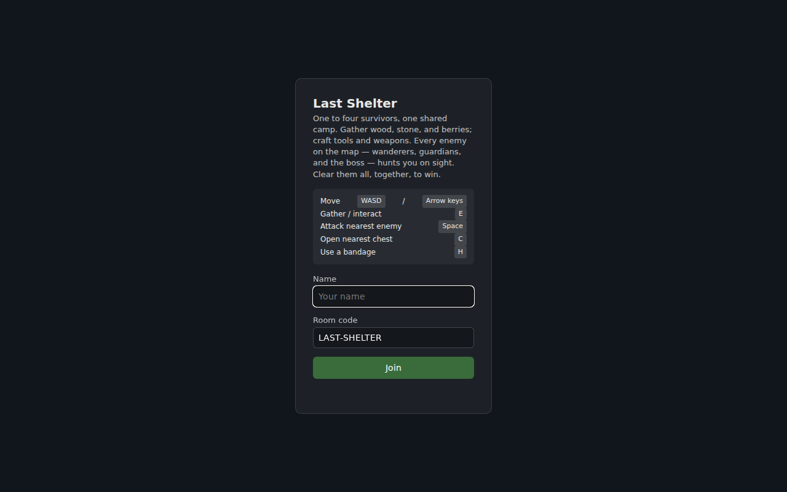
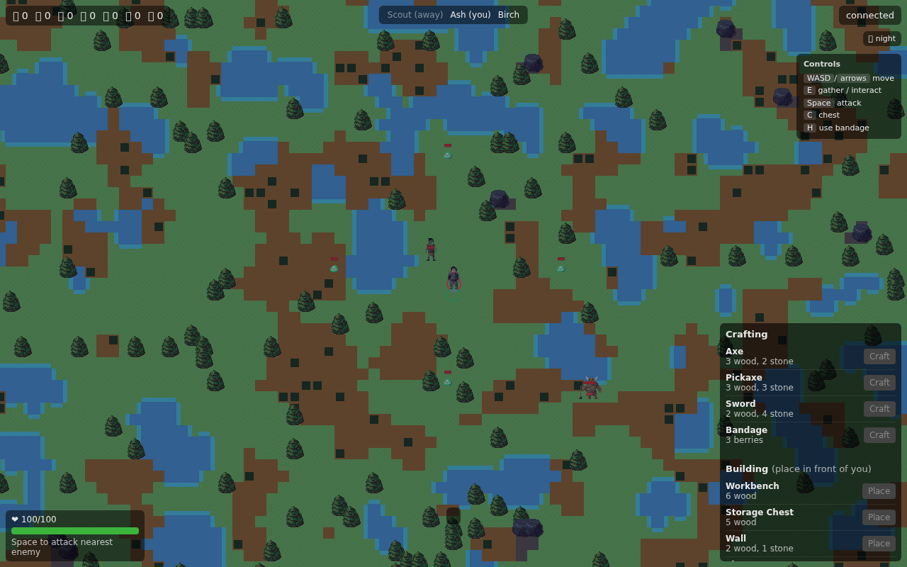
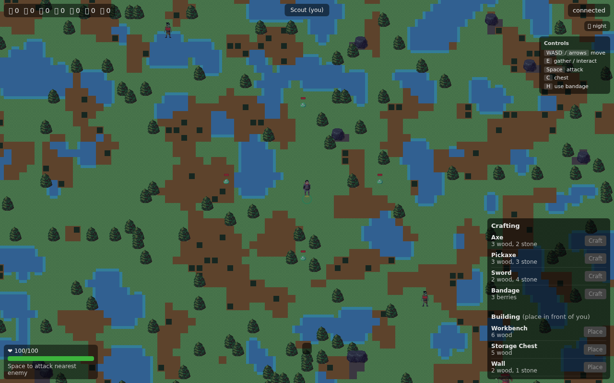

# Process overview

> Assisted retrospective draft, based on preserved directives, implementation evidence, commit history and the author's account. For author review before submission.

Development sequence and source locations: [reflections/](https://github.com/comp4020-agentic-coding-studio/comp4020-final-jojo111111111025/tree/2c8f70f3cec686cc0150e17500c40c0df0a6452d/reflections) · [docs/adr/](https://github.com/comp4020-agentic-coding-studio/comp4020-final-jojo111111111025/tree/2c8f70f3cec686cc0150e17500c40c0df0a6452d/docs/adr).

## 1. From a shared pixel wall to an authoritative game server

This repository's crit-8/9/10 history belonged to a different project, The Wall — a shared pixel wall where a brick landed in the next empty cell, identified by a signed cookie, protected from concurrent double-placement by a `PRIMARY KEY (x, y)` constraint ([crit-8](https://github.com/comp4020-agentic-coding-studio/comp4020-final-jojo111111111025/blob/a32a09853ad77da2cad9826a12011d5543e6826a/reflections/crit-8.md), [crit-9](https://github.com/comp4020-agentic-coding-studio/comp4020-final-jojo111111111025/blob/38c8fa5896e47b9f897d9a0ea6fdee32ebcc6190/reflections/crit-9.md), its [concurrent-placement](https://github.com/comp4020-agentic-coding-studio/comp4020-final-jojo111111111025/blob/54bcdcf975f5c39f3be62b74da563f2fbbeebfd6/docs/adr/001-concurrent-brick-placement.md) and [anonymous-identity](https://github.com/comp4020-agentic-coding-studio/comp4020-final-jojo111111111025/blob/41ddd3fc6135521ba443ca390b5d1479716bca04/docs/adr/002-anonymous-identity.md) ADRs). The final brief asked for something structurally different — several players moving, fighting, and building in one shared world at once — so Last Shelter was built as a separate tree rather than grown out of The Wall's one-request-one-row server, since a grid of independent HTTP inserts shares no architecture with a ticking, authoritative game loop. It was integrated onto this repository's preserved history afterward, which is why `main` still opens with The Wall.

A fresh join lands on a named room with a stated goal and a printed control legend, not a blank canvas:

## 2. Stack, and why

TypeScript throughout; `ws` for the WebSocket transport; `better-sqlite3` for synchronous, file-backed persistence; `zod` for wire-message validation; Vitest for unit and full wire-protocol integration tests. The client is vanilla TypeScript on Canvas 2D with native HTML UI — no framework, since the real complexity sits server-side (authoritative movement, combat, building), not in client UI state. The deploy target is one shared-cpu-1x Fly machine, 256 MB of memory, one mounted volume, no reachable database server — a budget that rules out anything needing its own process or network round trip for a routine check.

`better-sqlite3`'s synchronous API over an async driver, and a signed cookie over a server-side session table, were weighed the way The Wall's own identity ADR already had: each alternative trades one guarantee (atomicity, unforgeability) for a round trip or a table to prune, when the in-process alternative gives the same guarantee for free. Concretely, building placement races two players against the same cell:

Both requests pass the in-memory range/materials/occupancy check in the same tick — there is no earlier point at which "the cell's free" could be told apart between them. The constraint, not a re-check step, is the only thing that actually decides it, which is why no lock or queue sits in front of placement at all.

## 3. Where a passing suite described the wrong server

Development ran in four scoped phases, each gated by its own spec files: Phase A — seeded map, movement, gathering; Phase B — inventory, crafting, building, farming; Phase C — signed identity and reconnect; Phase D — survival, day/night, combat, a dungeon, a beacon win condition. Each phase's suite ran against a real HTTP+WS server, not mocks, so a pass meant the wire protocol behaved correctly, not just an internal function.

That didn't stop one phase's suite from passing for the wrong reason. Auditing in-memory/SQLite consistency between Phase C and D found the integration harness built its `Room` with no persistence hooks at all, unlike production — every Phase C test had driven a server that silently never wrote a gather/build mutation to disk, and "survives a restart" had never been exercised end-to-end. The fix wasn't a patch to the test: persistence wiring was factored into one shared function production and the harness both call, confirmed by a new integration spec asserting a full server restart.

A later usability pass delegated its own verification the same way: a controls legend, a toast for every server rejection reason, movement interpolation, and touch controls calling the exact same functions the keyboard handler calls, never a second implementation. Manual testing with two independent cookie jars against the live server — not a suite claiming it would — confirmed distinct identities, correct real-time propagation, a resolved gather race on a resource node's last unit, and identity/inventory surviving a genuine process restart:

## 4. Where a redesign exposed what a scope cut forgets

Pathfinding broke in a reproducible way: enemies chasing in a straight line could stall against a lake shoreline, or asymptotically creep toward a cell boundary without crossing it, confirmed with a boss and guardian each stuck for a 500+ simulated-second run. Movement now falls back to a per-target BFS distance field the instant either axis is blocked, committing to one cardinal step rather than re-fighting the still-blocked direct line every tick.

A larger scope cut replaced the beacon/dungeon win condition with "kill every enemy on the map." Farming and the dungeon's coordinate space were deleted outright. That left two consequences standing, contradicting the rule they weren't designed against: enemy respawn makes "kill every enemy" permanently unreachable, and night-only extra wanderer spawns were built to make the old beacon fight harder at night, not to coexist with a finite roster. Neither a type error nor a passing test would have caught this — only reading the new rule's implication against what already existed did. Both were cancelled outright.

Subsequent commits built real consequences on the simpler loop: death wipes a player's inventory and every building they own, and resets every enemy — dead ones included — so a death restarts the shared fight, not just the player. Tools gained real effects and limited durability, and the boss now actively chases rather than waiting at its spawn:

Locally, at the current `HEAD`: `pnpm typecheck` is clean, `pnpm build:client` succeeds, `pnpm test` passes 274/274 across 34 spec files against a real locally-running server, not mocks — local results from this session, not a fresh CI run. Not re-verified here: a deployed instance, a two-browser-profile session on it, or production logs; earlier history recorded a successful remote deploy and a passing CI Docker build, but neither was re-run. Position doesn't persist across a restart (identity and inventory do) — a known, stated gap, not a regression. Feature completeness is left to the marker's own pass against the deployed app, not restated here.
